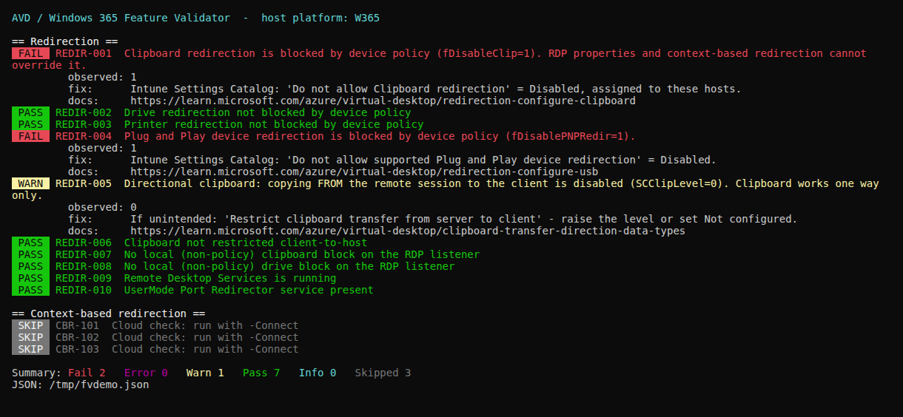

# feature-validator

Read-only validator for **Azure Virtual Desktop session hosts** and **Windows 365 Cloud
PCs**. Run it on the host. It reports, feature by feature, whether that feature can work
there and, if not, what's blocking it, with the fix and the Microsoft Learn page.

## Run it: single file (recommended)

[`dist/Invoke-FeatureValidator.ps1`](dist/Invoke-FeatureValidator.ps1) is one self-contained
script with the engine and every check built in. Copy it anywhere: a Cloud PC, an Intune
remediation, Azure Run Command, a ticket.

```powershell
# Downloaded file - supports every parameter and sets the process exit code
powershell -ExecutionPolicy Bypass -File .\Invoke-FeatureValidator.ps1

# Straight from GitHub, nothing saved to disk - parameters work, your window stays open
& ([scriptblock]::Create((irm https://raw.githubusercontent.com/Mauvlans/AVD/main/feature-validator/dist/Invoke-FeatureValidator.ps1))) -ShowSkipped
$LASTEXITCODE   # 0 = no FAIL/ERROR, 1 = at least one
```

Use the `[scriptblock]::Create` form rather than `irm ... | iex`: it accepts parameters and
runs in its own scope, so it doesn't leave the validator's variables in your session.

## Run it: from the repo

```powershell
powershell -ExecutionPolicy Bypass -File .\Invoke-FeatureValidator.ps1
```

Same behaviour; loads `lib/Engine.ps1` and `checks/*.psd1` from disk. Use this while
developing checks.



*Sample above is a real run against a test fixture (a Cloud PC with clipboard and PnP
blocked by device policy, and host-to-client clipboard disabled).*

## Reading the output

| Tag | Colour | Meaning |
|---|---|---|
| `FAIL` | red | The feature **cannot work** as configured. Fails the run. |
| `ERROR` | magenta | The validator couldn't read what it needed (probe failed). Fails the run. |
| `WARN` | yellow | Works, but degraded, one-way, or about to break. Does **not** fail the run. |
| `PASS` | green | Checked and fine. |
| `INFO` | cyan | Worth knowing, not a problem. |
| `SKIP` | grey | Not applicable to this platform, or needs `-Connect`. Hidden unless `-ShowSkipped`. |

Every `FAIL`/`WARN` prints what was observed, the fix, and the docs link. Exit `0` = no
FAIL/ERROR, exit `1` = at least one. `-NoColor` gives plain `[FAIL]`/`[WARN]` text for
logs and tickets.

JSON goes to `%ProgramData%\FeatureValidator\latest.json` (or `%LOCALAPPDATA%` when not
elevated, or `-OutputPath`).

## Parameters

| Parameter | |
|---|---|
| `-Feature Redirection` | Run only some features. |
| `-ShowSkipped` | Show skipped checks too. |
| `-Platform AVD\|W365` | Override platform detection (default `Auto`). |
| `-Connect` | Cloud-side checks (Entra / Intune via Graph). **Not implemented yet.** Cloud checks are listed as SKIP so you can see what's coming. |
| `-Fixture file.json` | Replace every probe with fixture data; touches no system state. For tests and for reproducing a report. |
| `-NoColor`, `-OutputPath` | |

## What it checks today

**Redirection** (local, both platforms):

- `REDIR-001..004`: clipboard, drive, printer and PnP/USB **blocked by device policy**
  (`fDisableClip`, `fDisableCdm`, `fDisableCpm`, `fDisablePNPRedir` = 1). This is the
  most restrictive gate; RDP properties and context-based redirection can't override it.
  New Windows 365 Cloud PCs ship with all four blocked.
- `REDIR-005/006`: directional clipboard set to 0 (one-way clipboard). WARN.
- `REDIR-007/008`: clipboard/drive disabled **directly on the RDP-Tcp listener**, which
  Intune and GPO reports won't show.
- `REDIR-009/010`: TermService running, UmRdpService present.

**Context-based redirection** (cloud, `-Connect`, not built yet): auth context
published, CA policy targets it, Windows Cloud Login sign-ins actually request it.

Next features, from [PLAN.md](PLAN.md): RDP Shortpath, Teams optimization, multimedia
redirection, SSO, FSLogix, watermarking / screen capture protection.

## Platform detection

Heuristic. **W365** if the computer name starts with `CPC-` or
`HKLM\SOFTWARE\Microsoft\Windows365` exists; **AVD** if `RDInfraAgent` is installed;
otherwise **Unknown**, and checks for both platforms run. Override with `-Platform`.

## Adding a check

Checks are data in `checks/*.psd1`; the engine (`lib/Engine.ps1`) doesn't change.

```powershell
@{
    Id         = 'REDIR-001'
    Feature    = 'Redirection'
    Title      = 'Clipboard redirection not blocked by device policy'   # shown on PASS
    Platform   = 'Both'           # AVD | W365 | Both
    Scope      = 'Local'          # Local | Cloud
    Probe      = @{ Type = 'Registry'; Path = 'HKLM:\...'; Name = 'fDisableClip' }
    Expect     = @{ NotEqual = 1 }  # Equal NotEqual In NotIn Exists NotExists MinVersion
    Severity   = 'Fail'           # what a failed expectation becomes: Fail | Warn | Info
    WhenFailed = 'Shown on FAIL/WARN.'
    Fix        = 'What to change.'
    DocLink    = 'https://learn.microsoft.com/...'
}
```

Probe types: `Registry`, `Service` (value = status, or not present), `File` (file version
or `Present`), `Process`, `Cloud`. A missing value/service/file is `$null`, so
`NotEqual 1` passes when a policy is *not configured*. That's intended: absence of a block
isn't a block. The catalog is validated at load. A malformed check stops the run rather
than silently passing.

## Building the single file

`dist/` is generated. Never edit it by hand. After changing `lib/`, `checks/` or
`Invoke-FeatureValidator.ps1`:

```powershell
pwsh -File .\build\Build-Standalone.ps1
pwsh -File .\Tests\Test-FeatureValidator.ps1
```

The build only inlines catalog files that load through `Import-PowerShellDataFile`
(data-only: no commands or variables), checks the result parses, and writes pure ASCII with **no BOM**.
A BOM breaks `irm` + `[scriptblock]::Create`, and non-ASCII text breaks Windows PowerShell 5.1;
the build refuses both. The tests fail if `dist/` is stale (engine,
any check file or the main script out of sync), so you can't forget to rebuild.

## Tests

```powershell
pwsh -File .\Tests\Test-FeatureValidator.ps1
```

76 offline tests covering catalog schema, expectation logic (including the inverted
"Do not allow… = 1 means blocked"), status → colour/exit-code mapping, five end-to-end
fixture scenarios in `Tests/fixtures/` run against **both** the repo script and the single
file, dist freshness, no-BOM/ASCII/parses-as-downloaded, and the scriptblock form (doesn't close the host, sets
`$LASTEXITCODE`). A deliberately inverted `NotEqual`
makes 13 of them fail, so they do catch the mistake they exist for.

**What they don't prove:** that a real host exposes these values where the catalog
looks. The fixtures are fixtures. Before calling a feature done, run it on a real Cloud
PC and a real AVD session host.

Requires Windows PowerShell 5.1 or PowerShell 7. Read-only: it never writes to the
registry, services or policy. Use [`redirection-apply/`](../redirection-apply/) to change
redirection.
